# FPGA-Based Secure Digital Voting Machine Using FSM and RTL Design

An educational digital design project implementing a secure, Finite State Machine (FSM)-driven Electronic Voting Machine (EVM) in synthesizable Verilog HDL. The design features candidate selection, switch-based voter authentication, double-voting prevention, time-multiplexed 7-segment display output, and an administrator result mode.

Targeted for the **Digilent Basys 3** development board (AMD/Xilinx Artix-7 `XC7A35T-1CPG236C`), and adaptable to any standard FPGA board.

---

## 🎬 Live and Interactive Simulation

The animated diagram below runs continuously, illustrating the real-time FSM state progression, signal path activations, status LEDs and 7-segment display decoding:

<p align="center">
  <a href="https://nityanand-7484.github.io/FPGA-Secure-Digital-Voting-Machine/">
    
  </a>
</p>

<p align="center">
  👉 <b><a href="https://nityanand-7484.github.io/FPGA-Secure-Digital-Voting-Machine/">Launch Live Interactive Web Simulator &amp; Step-by-Step Auto-Play Demo</a></b> 👈
</p>

---

## 📋 Table of Contents
1. [Project Overview & Key Features](#-project-overview--key-features)
2. [Hardware Specifications & Pin Mapping](#-hardware-specifications--pin-mapping)
3. [System Architecture & FSM Operation](#-system-architecture--fsm-operation)
4. [Project Directory Structure](#-project-directory-structure)
5. [Step-by-Step: How to Run in Xilinx Vivado](#-step-by-step-how-to-run-in-xilinx-vivado)
6. [Step-by-Step: How to Simulate (Icarus Verilog / ModelSim)](#-step-by-step-how-to-simulate-icarus-verilog--modelsim)
7. [Step-by-Step: How to Operate the Voting Machine](#-step-by-step-how-to-operate-the-voting-machine)
8. [Functional Verification & Test Cases](#-functional-verification--test-cases)
9. [Author & Academic Details](#-author--academic-details)

---

## 🌟 Project Overview & Key Features

* **Finite State Machine Control:** 7 discrete states (`IDLE`, `AUTH`, `SELECT`, `CONFIRM`, `CAST`, `LOCK`, `RESULT`) guarantee that voters can only follow authorized procedural paths.
* **Voter Authentication:** 4-bit switch-entry passcode verification prevents unauthorized access to the ballot.
* **Double-Voting Prevention:** Once a vote is cast, the machine enters a persistent `LOCK` state, completely ignoring all voter input buttons until an election official authorizes the next session.
* **Voter Re-selection:** Allows voters to cancel an accidental choice and re-select prior to final confirmation.
* **Time-Multiplexed 7-Segment Display:** Renders human-readable messages (`rdy `, `PASS`, `FAIL`, `SELC`, `YES `, `dOnE`) and numeric candidate tallies (`A002`, `b000`, `C001`, `d000`).
* **Hardware Debouncing:** All mechanical push buttons pass through dedicated 2-stage synchronizers and clock-based debouncers to generate clean, single-clock-cycle pulses.
* **Gated Admin Mode:** Vote tallies are stored in 16-bit registers (up to 65,535 votes per candidate) and remain concealed until unlocked via an administrator switch.

---

## 🔌 Hardware Specifications & Pin Mapping

The project includes pre-configured constraints for the **Digilent Basys 3** board:

| Physical Control | Basys 3 Pin | Verilog Port | Function |
| :--- | :--- | :--- | :--- |
| **100 MHz Oscillator** | `W5` | `clk` | Master system clock |
| **Center Push Button** | `U18` | `reset` | Active-high master system reset |
| **Up Push Button** | `T18` | `auth_enter` | Enter / submit passcode |
| **Right Push Button** | `T17` | `confirm_btn` | Confirm vote (YES) / Cycle admin results |
| **Left Push Button** | `W19` | `cancel_btn` | Cancel vote (NO) / Re-select candidate |
| **Down Push Button** | `U17` | `new_session_btn`| Polling official key to unlock next voter |
| **Switches 0 to 3** | `V17, V16, W16, W17` | `auth_code[3:0]` | 4-bit binary passcode (Default: `1011`) |
| **Switches 4 to 7** | `W15, V15, W14, W13` | `candidate_btn[3:0]`| Candidate selection (A, B, C, D) |
| **Switch 15** | `R2` | `admin_mode` | Admin result inspection toggle switch |
| **LED 0** | `U16` | `status_led[0]` | System Ready (`IDLE` state) |
| **LED 1** | `E19` | `status_led[1]` | Authentication Successful |
| **LED 2** | `U19` | `status_led[2]` | Candidate Selected |
| **LED 3** | `V19` | `status_led[3]` | Vote Cast / Session Locked |
| **7-Seg Cathodes** | `W7..U7` | `seg[6:0]` | Cathode segments `{g, f, e, d, c, b, a}` |
| **7-Seg Anodes** | `U2, U4, V4, W4` | `an[3:0]` | Anode digit enables `{AN0, AN1, AN2, AN3}` |

---

## 🏛️ System Architecture & FSM Operation

```text
               +-------------------------------------------+
               |                  IDLE                     |<-------+
               +-------------------------------------------+        |
                 | (auth_enter)             | (admin_mode=1)        |
                 v                          v                       |
         +----------------+          +----------------+             |
         | AUTHENTICATION |          |  ADMIN RESULT  |             |
         +----------------+          |  (Cycle A-D)   |             |
                 | (Valid Code)      +----------------+             |
                 v                          | (admin_mode=0)        |
         +----------------+                 v                       |
+------->| CANDIDATE SEL. |          (Back to IDLE)                 |
|        +----------------+                                         |
|                | (Candidate Button)                               |
|                v                                                  |
|        +----------------+                                         |
+--------|  CONFIRMATION  |                                         |
 (Cancel)+----------------+                                         |
                 | (Confirm YES)                                    |
                 v                                                  |
         +----------------+                                         |
         |   VOTE CAST    | (1-cycle pulse increments counter)      |
         +----------------+                                         |
                 |                                                  |
                 v                                                  |
         +----------------+                                         |
         |  SESSION LOCK  |-----------------------------------------+
         +----------------+            (new_session_btn)
```

---

## 📁 Project Directory Structure

```text
FPGA_Voting_Machine_Project/
├── src/                                  # Synthesizable RTL Verilog Modules
│   ├── authentication.v                  # Passcode comparison logic
│   ├── button_debounce.v                 # Mechanical glitch filter & pulse generator
│   ├── candidate_selector.v              # Candidate push-button decoder (A, B, C, D)
│   ├── result_controller.v               # Admin tally multiplexer & display cycler
│   ├── seven_segment.v                   # Multiplexed 4-digit display controller
│   ├── vote_counter.v                    # 16-bit per-candidate tally registers
│   ├── voting_fsm.v                      # Central 7-state controller FSM
│   └── voting_machine_top.v              # Top-level integration & port mapping
├── tb/                                   # Simulation Testbenches
│   └── voting_machine_tb.v               # Self-checking testbench for all test cases
├── constraints/                          # Hardware Board Pin Constraints
│   └── Basys3_Master.xdc                 # Complete pin mappings for Digilent Basys 3
├── docs/                                 # Web Documentation & Visual Assets
│   ├── index.html                        # Interactive Web Simulator & Auto-Player
│   └── fsm_animation.svg                 # Native Animated SVG (renders directly on GitHub)
├── .gitignore                            # Excludes EDA build files & private reports
└── README.md                             # Comprehensive Documentation
```

---

## 🚀 Step-by-Step: How to Run in Xilinx Vivado

### Step 1: Open Vivado & Create a New Project
1. Launch **Xilinx Vivado** (2019.1, 2020.x, 2022.x, or newer).
2. Click **Create Project** $\rightarrow$ Click **Next**.
3. Name your project (e.g., `Voting_Machine_Vivado`) and select project location.
4. Set Project Type to **RTL Project** $\rightarrow$ Click **Next**.

### Step 2: Select the Target FPGA Board
* Under the **Parts** tab:
  * Select Part: **`xc7a35tcpg236-1`** (This corresponds to the Digilent Basys 3 Artix-7 chip).
* Click **Next** $\rightarrow$ Click **Finish**.

### Step 3: Add Design Sources
1. In the **Flow Navigator** (left pane), click **Add Sources** under *Project Manager*.
2. Select **Add or create design sources** $\rightarrow$ Click **Next**.
3. Click **Add Files** $\rightarrow$ Navigate to `FPGA_Voting_Machine_Project/src/`.
4. Select all 8 `.v` files:
   * `voting_machine_top.v`
   * `voting_fsm.v`
   * `authentication.v`
   * `candidate_selector.v`
   * `vote_counter.v`
   * `button_debounce.v`
   * `seven_segment.v`
   * `result_controller.v`
5. Click **OK** $\rightarrow$ Ensure `voting_machine_top.v` is set as the Top module.

### Step 4: Add Constraints
1. Click **Add Sources** $\rightarrow$ Select **Add or create constraints** $\rightarrow$ Click **Next**.
2. Click **Add Files** $\rightarrow$ Select `constraints/Basys3_Master.xdc` $\rightarrow$ Click **Finish**.

### Step 5: Add Simulation Sources
1. Click **Add Sources** $\rightarrow$ Select **Add or create simulation sources** $\rightarrow$ Click **Next**.
2. Click **Add Files** $\rightarrow$ Select `tb/voting_machine_tb.v` $\rightarrow$ Click **Finish**.

### Step 6: Run Behavioral Simulation
1. Under **Flow Navigator**, click **Run Simulation** $\rightarrow$ **Run Behavioral Simulation**.
2. The simulation waveform will open, and the Vivado Tcl Console will print the step-by-step execution:
   * Tests T1 to T7 execution.
   * Multi-voter tally verification ($A=2, B=0, C=1, D=0$).
   * Double-voting block verification.
   * Console will display: `>>> [ALL TESTS PASSED] MULTI-VOTER VERIFICATION & SYSTEM TALLY SUCCESSFUL! <<<`.

### Step 7: Run Synthesis & Implementation
1. In Flow Navigator, click **Run Synthesis** (wait for completion).
2. Click **Run Implementation** (wait for place & route).
3. Review the **Project Summary** to inspect resource utilization (LUTs, Flip-Flops, I/O buffers).

### Step 8: Generate Bitstream & Program the Board
1. Click **Generate Bitstream** (creates `voting_machine_top.bit`).
2. Connect your **Digilent Basys 3** board to your PC using a micro-USB cable.
3. Power on the board (flip power switch).
4. In Flow Navigator, click **Open Hardware Manager** $\rightarrow$ **Auto Connect**.
5. Right-click on `xc7a35t_0` $\rightarrow$ Select **Program Device** $\rightarrow$ Select your `.bit` file $\rightarrow$ Click **Program**.

---

## 💻 Step-by-Step: How to Simulate (Icarus Verilog / ModelSim)

You can also run verification in open-source CLI simulators without launching Vivado:

### Using Icarus Verilog (`iverilog`) & GTKWave:
```bash
# 1. Compile the top-level RTL and testbench
iverilog -o voting_sim.vvp -I src src/*.v tb/voting_machine_tb.v

# 2. Run the simulation
vvp voting_sim.vvp

# 3. View waveforms (optional)
gtkwave dump.vcd
```

### Using ModelSim / QuestaSim:
```tcl
vlib work
vlog src/*.v tb/voting_machine_tb.v
vsim -c voting_machine_tb -do "run -all; quit"
```

---

## 🗳️ Step-by-Step: How to Operate the Voting Machine

Once programmed on the physical Basys 3 FPGA, follow this procedure for voting:

```text
+-----------------------------------------------------------------------------------+
| PROCEDURE 1: NORMAL VOTING SESSION                                                |
+-----------------------------------------------------------------------------------+
| 1. SYSTEM READY:                                                                  |
|    - 7-Segment display shows: "rdy "                                              |
|    - Status LED0 (LD0) is lit (System Ready).                                     |
|                                                                                   |
| 2. VOTER AUTHENTICATION:                                                          |
|    - Set slide switches SW3..SW0 to the 4-bit passcode (Default: 1011).          |
|    - Press the UP push button (BtnU / auth_enter).                                |
|    - If correct: Display updates to "SELC" and LED1 turns ON.                     |
|    - If incorrect: Display indicates "FAIL" and remains locked in AUTH.           |
|                                                                                   |
| 3. CANDIDATE SELECTION:                                                           |
|    - Choose a candidate by asserting one switch (SW4=A, SW5=B, SW6=C, SW7=D).     |
|    - Display prompts: "yES " (or Candidate indicator) and LED2 turns ON.         |
|                                                                                   |
| 4. CONFIRM OR CANCEL:                                                             |
|    - To CANCEL: Press LEFT push button (BtnL). Display returns to "SELC".         |
|    - To CONFIRM: Press RIGHT push button (BtnR).                                  |
|                                                                                   |
| 5. VOTE RECORDED & SESSION LOCKOUT:                                               |
|    - Internal 16-bit tally register increments by 1.                              |
|    - Display shows: "dOnE" and LED3 turns ON (Session Locked).                    |
|    - Any further button presses by the voter are completely ignored.              |
|                                                                                   |
| 6. NEXT VOTER AUTHORIZATION:                                                      |
|    - Polling Officer presses DOWN push button (BtnD / new_session).               |
|    - Machine resets to "rdy " for the next citizen.                               |
+-----------------------------------------------------------------------------------+

+-----------------------------------------------------------------------------------+
| PROCEDURE 2: ELECTION OFFICER RESULT INSPECTION (ADMIN MODE)                      |
+-----------------------------------------------------------------------------------+
| 1. While the machine is in the "rdy " (IDLE) state, flip switch SW15 (admin_mode)|
|    to the ON (high) position.                                                     |
| 2. All 4 status LEDs turn ON, indicating Admin Mode.                              |
| 3. The 7-segment display displays Candidate A's tally: "A 002".                   |
| 4. Press the RIGHT push button (BtnR) to cycle through tallies:                   |
|    - 1st press: Candidate B tally (e.g., "b 000")                                 |
|    - 2nd press: Candidate C tally (e.g., "C 001")                                 |
|    - 3rd press: Candidate D tally (e.g., "d 000")                                 |
|    - 4th press: Wraps back to Candidate A ("A 002")                               |
| 5. Flip switch SW15 back to OFF to return the machine safely to IDLE.             |
+-----------------------------------------------------------------------------------+
```

---

## 🧪 Functional Verification & Test Cases

The self-checking testbench (`tb/voting_machine_tb.v`) verifies 7 key functional tests and models a multi-voter sequence:

| Test ID | Scenario Tested | Stimulus Applied | Expected Hardware Outcome | Verified Status |
| :--- | :--- | :--- | :--- | :--- |
| **T1** | Valid Authentication | `auth_code = 4'b1011` + `auth_enter` pulse | FSM moves `IDLE` $\rightarrow$ `SELECT`; display shows `SELC` | **PASSED** |
| **T2** | Invalid Authentication | `auth_code = 4'b0101` + `auth_enter` pulse | FSM remains in `AUTH`; display shows `FAIL` | **PASSED** |
| **T3** | Candidate Selection | Press `candidate_btn[0]` during `SELECT` | Candidate A encoded (`2'b00`); moves to `CONFIRM` | **PASSED** |
| **T4** | Candidate Re-selection | Press `cancel_btn` during `CONFIRM` | FSM returns to `SELECT`; enables new choice | **PASSED** |
| **T5** | Vote Casting | Press `confirm_btn` during `CONFIRM` | Candidate counter increments; FSM moves to `LOCK` | **PASSED** |
| **T6** | Double-Voting Prevention | Press candidate/confirm buttons in `LOCK` | Buttons ignored; FSM stays in `LOCK`; tally unchanged | **PASSED** |
| **T7** | Admin Result Readout | Assert `admin_mode = 1` from `IDLE` | FSM moves to `RESULT`; cycles through tallies | **PASSED** |

### Multi-Voter Verification Sequence (Table 4.2 in Report):
1. **Voter 1:** Authenticates $\rightarrow$ Selects Candidate A $\rightarrow$ Confirms $\rightarrow$ Locked.
2. **Voter 2:** Authenticates $\rightarrow$ Selects Candidate B $\rightarrow$ Cancels $\rightarrow$ Selects Candidate C $\rightarrow$ Confirms $\rightarrow$ Locked.
3. **Voter 3:** Authenticates $\rightarrow$ Selects Candidate A $\rightarrow$ Confirms $\rightarrow$ Locked.
* **Final Verified Tallies:**
  $$\text{Candidate A} = 2, \quad \text{Candidate B} = 0, \quad \text{Candidate C} = 1, \quad \text{Candidate D} = 0$$

---

## 👤 Author & Academic Details

* **Project Title:** FPGA-Based Secure Digital Voting Machine Using FSM and RTL Design
* **Author:** Nityanand Kumar
* **Department:** Electronics & Communication Engineering
* **Repository:** [https://github.com/Nityanand-7484/FPGA-Secure-Digital-Voting-Machine](https://github.com/Nityanand-7484/FPGA-Secure-Digital-Voting-Machine)
